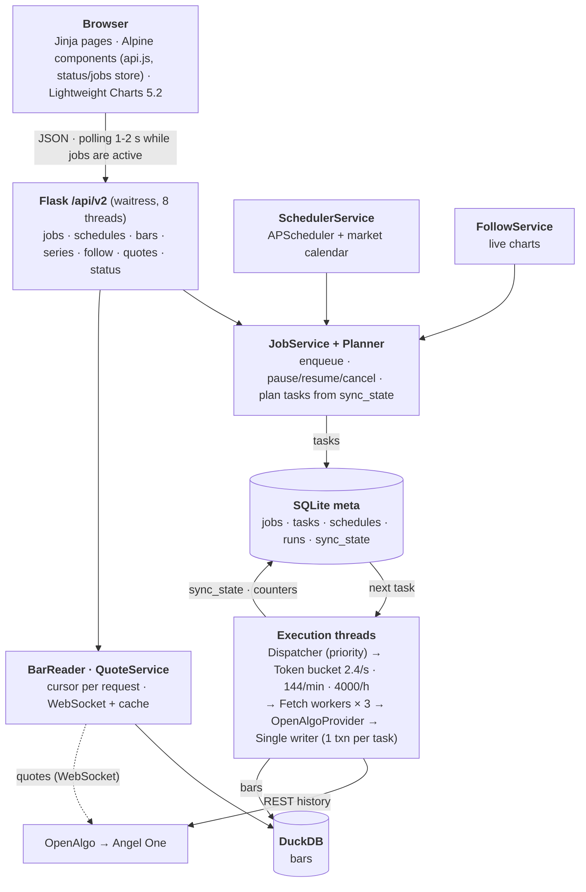
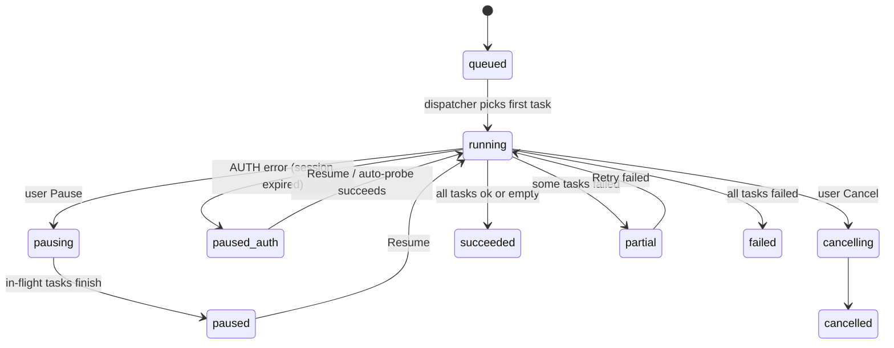
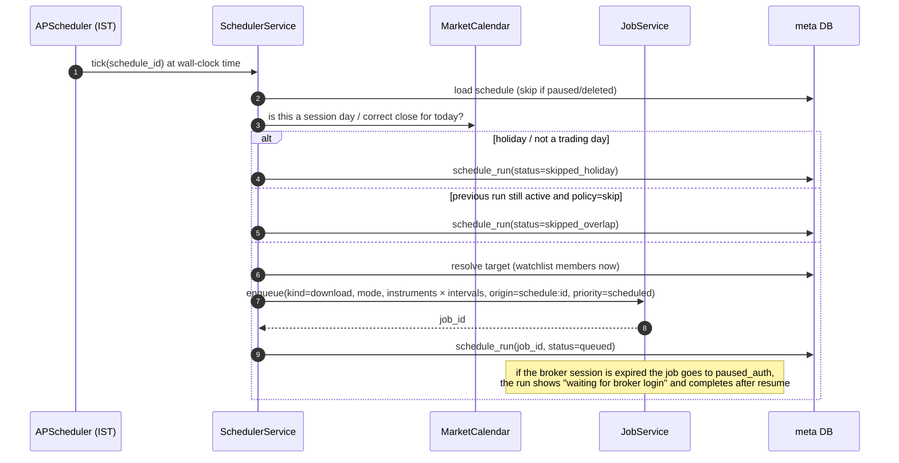
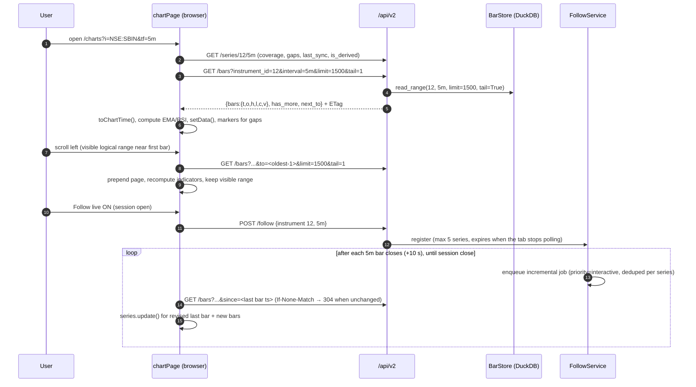
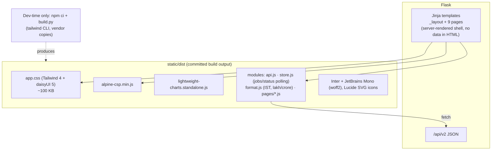

# Historify v2 — High-Level Design: Charts, Scheduler & UI

> **Status:** implemented (Phase 3 + 4). Results: [`../metrics/PHASE_3_4_RESULTS.md`](../metrics/PHASE_3_4_RESULTS.md); screenshots of the real app: [`../../design/phase4-screens`](../../design/phase4-screens). Deviations from this design are listed in the Phase 3-4 implementation report (section 7).

| | |
|---|---|
| **Covers** | Plan Phase 4 (scheduler, read path/charts, UI) **and** the Phase 3 job engine it runs on |
| **Status** | For review. No production code has been changed for this phase. |
| **Prototype** | `design/phase4-prototype/`: clickable static pages built with the proposed stack (Tailwind 4 + daisyUI 5, Alpine.js CSP build, Lightweight Charts 5.2, offline assets). Open `html/dashboard.html` in a browser; screenshots are in `screenshots/`. |
| **Assumed "now" in mockups** | Fri 28 Mar 2025, 15:48 IST (NSE closed; post-close job running) |
| **Diagrams** | Mermaid below (renders on GitHub); PNG renders of every diagram in `design/phase4-prototype/diagrams/` |

---

## 0. Summary and one dependency to decide first

The scheduler, the Jobs page, "follow live" charts and every Data Manager action all **create jobs**. In the approved plan, the job engine is **Phase 3**, which has not been built yet; Phases 1–2 delivered the storage foundation only. The scheduler cannot be redesigned properly without it: today's scheduler downloads inline, and that is the root of SC-02, CP-03 and CP-04.

**Recommendation (decision D1):** build Phase 3 and Phase 4 as one stretch, in this order:

| Step | Scope | Effort |
|---|---|---|
| **3** | Job engine: planner, tasks, dispatcher, rate-limited workers, single writer, sync_state, API v2 jobs | 8–10 d |
| **4a** | Scheduler on the job engine (calendar-aware triggers, run history, catch-up) | 3–4 d |
| **4b** | Read path + charts (bars API, paging, follow live, W/M) | 4–5 d |
| **4c** | UI (new shell + 9 pages, asset pipeline, CSP) | 9–11 d |

**Total ≈ 24–30 engineer-days (5–6 weeks).** Each step ships working software: after 3 the existing download page can already enqueue jobs; after 4a schedules run through the engine; and so on.

---

## 1. Planned changes at a glance

### 1.1 Charts
| Today (v1) | Planned (v2) | Finding |
|---|---|---|
| `GET /charts/api/chart-data/<sym>/<ex>/<iv>/<ema>/<rsi>` returns the **entire history** on every load and every auto-refresh (1.4 MB for 7,500 bars) | `GET /api/v2/bars`: columnar, **paged (1,500 bars)**, `since=` incremental updates, ETag/304 | CH-01 |
| Indicators computed in pandas on the server per request | EMA/SMA/RSI/MACD computed **in the browser** over loaded bars | CH-01 |
| Two separate chart instances (price + RSI) kept in sync by hand | One chart with **native panes** (LWC 5.2): price + EMAs + volume, RSI pane, optional MACD pane | — |
| Timezone split: server converts, client adds +5.5 h for intraday only, daily sent as string or int | One helper `toChartTime(epoch)`; canonical UTC epochs from the store; IST labels for every interval | CH-03 |
| Auto-refresh on a blind timer, even when the market is closed | **Follow live**: incremental job after each bar closes, only during the exchange session | — |
| W/M = mislabelled daily data | W/M **derived from D** by the BarStore (`resample`) | DL-04 |
| Exchange picked separately from the symbol (wrong combinations possible) | Instrument picker (symbol + exchange = one instrument) | CH-04 |
| "No data" = error toast | Empty state with **"Download this series"** → job → chart renders when done | — |
| Gaps invisible | **Gap markers** on the chart + per-session **coverage strip** + "Repair" | CP-06 |

### 1.2 Scheduler
| Today (v1) | Planned (v2) | Finding |
|---|---|---|
| APScheduler callback downloads inline (and "Run now" downloads inside the HTTP request) | Triggers only **enqueue jobs**; the engine does the work | SC-02 |
| `daily` / `interval` / fixed presets 15:35 & 08:30, blind to the calendar | **Market-event triggers** (after close / before open ± offset per exchange), **during-session** intervals, cron, one-off | SC-05, SC-07 |
| Runs on holidays and weekends (→ "failures") | Calendar-aware; holidays recorded as `skipped_holiday` | DL-03 |
| No history (`get_job_history` returns `[]`) | `schedule_runs` linked to jobs: outcome, requests, rows | SC-03 |
| Missed runs (app closed at 15:35) are lost | **Catch-up** on start within a grace window | SC-05 |
| Overlapping runs pile up | **Overlap policy**: skip or queue | — |
| Watchlist only; no symbol/interval targeting in the UI | Target = watchlist (resolved at fire time) or instruments × intervals | SC-07 |
| Daily job skips today's bar; intraday look-back capped at 3/7 days | Planner with interval-aware `sync_state`, finality, no caps | CP-03, CP-04 |
| Expired broker session → every symbol fails | Job pauses (`paused_auth`), run shows "waiting for login", resumes | — |

### 1.3 UI
| Today (v1) | Planned (v2) | Finding |
|---|---|---|
| 10 templates, ~4.6k lines of page JS with duplicated fetch/toast/render code; **3 different download UIs** | Shared shell + 9 pages; Alpine.js components + shared `api.js`; one **New Download** flow | UI-01 |
| Dashboard numbers hard-coded | Real metrics from `sync_state`, jobs and schedule runs | UI-03 |
| Progress, pause, cancel, retry are cosmetic | **Jobs** page on the real engine | UI-02 |
| No view of what data exists | **Data Manager** coverage matrix + per-session calendar + bulk actions | UI-10 |
| Tailwind 2.2 + DaisyUI 3 + FontAwesome + Google Fonts from CDNs (breaks offline, no SRI) | Tailwind 4 + daisyUI 5 **compiled at dev time**; Inter, Lucide icons and JS **vendored**; no runtime CDN | UI-06 |
| 90 `innerHTML` sinks; inline `onclick` handlers | No data in `innerHTML` (lint rule); Alpine **CSP build** → strict CSP without `unsafe-eval`/`unsafe-inline` script | UI-07, SEC-05 |
| Settings page: 7 of 9 controls do nothing | Every control maps to a real setting (limits, chunk sizes, timeouts, budget) | UI-04 |
| Quotes: one REST call per symbol on page load | OpenAlgo WebSocket feed + server cache (REST fallback) | UI-08 |
| Excel import mock; export via session cookie | Real import with per-row validation; **export = async job** with a streamed file | EX-01..07 |

Files retired at the end of 4c: `templates/{index,dashboard,download,charts,scheduler,watchlist,import,export,settings}.html` (replaced); `static/js/*.js` (replaced by ~8 small modules); `static/css/{design-system,style,modal}.css` (replaced by one compiled `app.css`); `routes/{api,charts,scheduler,watchlist}.py` (replaced by `/api/v2`); `utils/scheduler.py` (replaced by `app/core/scheduling`). The v1 storage code (`models/dynamic_tables.py`, `checkpoint.py`) is deleted in Phase 5 as planned.

---

## 2. Runtime architecture

Everything runs in **one process** (the DuckDB single-writer constraint, D2 local single-user), owned via the instance lock delivered in Phase 1.



**Cutover (decision D4):** when 4c ships, the v2 engine and UI become the default. On first start, if a v1 `historify.db` exists, a guided **import step** runs the Phase 2 importer (read-only on v1, backup, reconciliation report). The v1 code stays in the repository until Phase 5 but is no longer routed. Rollback is git tag `v1.2.1`; the v1 DB is untouched.

---

## 3. How jobs run (Phase 3 engine, the foundation)

### 3.1 Model
- **Job** = one user intent: "post-close update", "download SBIN 5m 1y", "export…". Has an origin (`ui`, `schedule:<id>`, `follow:<series>`, `repair`) and a **priority**: `interactive` > `scheduled` > `backfill`.
- **Task** = one request-sized unit: *(instrument, interval, date chunk)*. Chunks respect the broker max-days (Angel One: 1m 30 d, 5m 100 d, D 2000 d).
- **Planner** (pure function) turns a job into tasks using `sync_state` and the market calendar:
  - `incremental`: resume from the last *final* bar; re-fetch the last session (intraday) or the last 2 trading days (D); never beyond "now".
  - `fixed`: an explicit date range.
  - `repair`: only sessions whose bar count is below the calendar's expectation.

### 3.2 Lifecycle

```mermaid
stateDiagram-v2
  [*] --> queued
  queued --> running
  running --> succeeded : bars written (replace-range + sync_state, one txn)
  running --> empty : NO_DATA on a non-session / pre-listing range
  running --> retry_wait : TRANSIENT or RATE_LIMITED (backoff + jitter)
  retry_wait --> queued : next_attempt_at reached
  running --> failed : PERMANENT, or retries exhausted
  running --> queued : AUTH (job pauses; task not counted as an attempt)
  queued --> cancelled
```





### 3.3 Execution rules
- **Dispatch order:** priority, then job FIFO, then task order. Big backfills **yield between tasks**, so a 15:45 scheduled run never waits behind a 6-hour 1-minute backfill.
- **Rate limits:** every request passes the shared multi-window token bucket (Phase 1), so the app can never exceed Angel One's limits even with three workers, schedules and follow-live all active.
- **Single writer:** each task commits `replace_range` + `sync_state` + job counters in **one transaction**, so a watermark can never run ahead of stored data (CP-02 fix by construction).
- **Restart safety:** on start, `running` tasks go back to `queued`; jobs resume. The hourly budget already used is persisted, so a restart can't burst past 5,000/h.
- **Progress:** `GET /api/v2/jobs/{id}` returns counters, rows, rate, budget and an ETA computed from the token bucket (hourly-cap aware). The UI polls every 1–2 s while jobs are active, every 15 s otherwise.

---

## 4. How scheduler jobs run

### 4.1 Concepts

| Concept | Options | Notes |
|---|---|---|
| **Trigger** | `market_event` (after close / before open, exchange, offset) · `session_interval` (every N min while the exchange is open) · `cron` (advanced, IST) · `once` (date-time) | Market triggers use the exchange calendar: MCX's close moves with US DST (23:30 / 23:55); special sessions (e.g. Muhurat) use their own hours |
| **Target** | watchlist (members **resolved at fire time**) or a fixed list of instruments | the same symbol on two exchanges = two instruments |
| **Intervals** | any native interval; W/M not selectable (derived) | |
| **Mode** | incremental (default) · repair gaps · fixed range (for `once`) | |
| **Overlap policy** | skip (default) · queue | if the previous run's job is still active |
| **Catch-up** | run once on start if the trigger was missed within N h (default 6 h) · skip | app was closed at the trigger time |

`schedules.trigger_json` examples:
```json
{"type": "market_event", "event": "after_close", "exchange": "NSE", "offset_min": 15}
{"type": "session_interval", "exchange": "NSE", "every_min": 5, "start_offset_min": 5}
{"type": "cron", "expr": "0 10 * * SUN"}
{"type": "once", "at": "2025-03-29T22:00:00+05:30"}
```

### 4.2 Firing a schedule



- **Why fire on plain weekday times and check the calendar at fire time:** every trigger leaves an auditable record, including holiday skips. This answers "why is there no data for 14 Mar?" without log files. **Next-run display** uses a separate calendar-aware preview function, so the UI never shows a holiday as the next run.
- **Catch-up on start:** for each schedule, compare the last expected fire time (from the preview function) with the last `schedule_run`. If it's missing and within the grace window, fire once with `origin=catch_up`. This is safe because runs are incremental and idempotent.
- **APScheduler** holds only in-memory triggers rebuilt from the `schedules` table on start. The table is the source of truth, so there is no second job store to drift.

### 4.3 A trading day with the default schedules (Angel One, 48 instruments)

```mermaid
gantt
  title Fri 28 Mar 2025 (IST) - default schedules
  dateFormat HH:mm
  axisFormat %H:%M
  section NSE session
  Market open                        :milestone, 09:15, 0m
  Market close                       :milestone, 15:30, 0m
  section Schedules
  Pre-open daily check (48 x D, ~20 s)        :done, 08:45, 2m
  Intraday 5m F&O every 5 min (10 x 5m)       :active, 09:20, 370m
  Post-close update (48 x D,5m,1m, ~3-6 min)  :crit, 15:45, 6m
  MCX evening close (4 x D,15m)               :23:40, 1m
```



| Run | Requests | Duration at 2.4 req/s | Share of the 4,000/h budget |
|---|---|---|---|
| Pre-open daily check | 48 | ~20 s | 1.2% |
| Intraday 5m F&O (each) | 10 | ~4 s | 0.25% per run (~18% of one hour across the day) |
| Post-close update | 144 | ~60 s of requests (+ writes) | 3.6% |
| Weekly gap repair | depends on gaps | - | runs Sunday, outside sessions |
| 1y 1m backfill, NIFTY 50 (once, Sat 22:00) | 650 | ~5 min | 16% |

### 4.4 Run outcomes (what the UI shows)
`queued` · `running` · `succeeded` · `partial` (some tasks failed) · `failed` · `skipped_holiday` · `skipped_overlap` · `waiting_auth` (job paused for login) · `catch_up` (flag on a normal run) · `cancelled`.

### 4.5 Migration of v1 scheduler jobs
On import, v1 `scheduler_jobs` rows are converted:

| v1 job | v2 schedule |
|---|---|
| `market_close` (15:35) | `market_event after_close NSE +15` (15:45; bars are final, decision D5) |
| `pre_market` (08:30) | `before_open NSE -30` (08:45) |
| `daily HH:MM` | `cron` at the same time on weekdays |
| `interval N` | `session_interval` every N min (v1 ran all day; outside sessions those runs only produced "no data" failures) |
| jobs with interval `W`/`M` | converted to `D` (W/M are derived), with a note in the import report |

### 4.6 Scheduler API
`GET/POST /api/v2/schedules` · `GET/PATCH/DELETE /api/v2/schedules/{id}` · `POST /api/v2/schedules/{id}/run` (→ 202 job_id) · `GET /api/v2/schedules/{id}/runs` · `POST /api/v2/schedules/preview` (next N fire times + holiday skips + request/duration estimate; powers the editor preview).

---

## 5. How charts work


*Prototype: SBIN 5m from the proposed `/api/v2/bars` payload. Native panes (candles + EMA 20/50 + volume; RSI 14), IST axis, gap marker on the bar after the missing 26 Mar session, coverage strip below. Dark mode: `screenshots/charts-dark.png`.*

### 5.1 Data flow



### 5.2 API contract
```
GET /api/v2/bars?instrument_id=12&interval=5m&limit=1500&tail=1[&to=<epoch>][&since=<epoch>]
200 ETag: "12-5m-1743155700-3150"
{
  "instrument": {"id": 12, "symbol": "SBIN", "exchange": "NSE"},
  "interval": "5m", "tz": "Asia/Kolkata", "derived": false,
  "bars": {"t": [...epoch s, bar open...], "o": [...], "h": [...], "l": [...], "c": [...], "v": [...]},
  "has_more": true, "next_to": 1741158000
}
```
- **Columnar arrays**: a 1,500-bar page is ~60 KB JSON (~15 KB gzip), versus 1.4 MB for the full history today.
- `since` is **inclusive** of the last bar, so a revised (previously partial) bar is returned and replaced.
- `W` and `M` are answered by `BarStore.resample()` from D, with `"derived": true`.
- `GET /api/v2/series/{instrument}/{interval}` returns coverage: first/last bar, count, missing sessions (calendar vs `daily_counts`), last sync, freshness (last *final* bar).

### 5.3 Time handling (one rule)
- The store holds bar-open UTC epochs; daily bars sit at 00:00 IST of the trading date (Phase 2).
- Lightweight Charts labels time in UTC, so the client applies **one** function, `toChartTime(epoch) = epoch + 19800`. Every label is then IST wall-clock, and daily bars fall on their trading date. There are no per-interval branches (this replaces CH-03's split logic).
- The time axis is **index-based**: a missing session leaves no visible hole (the prototype shows 25 → 27 with no 26). Gaps are therefore made explicit with a **marker** on the first bar after the gap, plus the **coverage strip**. This was confirmed while building the prototype.

### 5.4 Rendering and indicators
- **Pane 0:** candles, EMA/SMA overlays, and volume histogram on its own price scale (bottom 20%). **Pane 1:** RSI with 30/70 lines. **Pane 2 (optional):** MACD. Panes are resizable; stretch factors are persisted.
- **Indicators** are computed client-side over the loaded bars (O(n), about 1 ms per 10k bars) and recomputed when older pages are prepended. Indicator choices persist in `localStorage` and in the URL (`&ind=ema20,ema50,rsi14`).
- **Legend** follows the crosshair (OHLC, % change, volume in lakh/crore, indicator values) and is written via Alpine state (no `innerHTML`).
- **TradingView attribution logo stays on** (`attributionLogo: true`), as required by the Lightweight Charts NOTICE.

### 5.5 Interaction
- **Toolbar:** instrument picker, intervals `1m 3m 5m 15m 30m 1h | D W M`, ranges `1D 5D 1M 3M 1Y All`, Indicators, **Follow live**, save image (`takeScreenshot`), full screen.
- **Keyboard:** `/` search, `←`/`→` scroll, `+`/`−` zoom, `Esc` closes panels.
- **URL is the state** (`?i=NSE:SBIN&tf=5m&ind=…`): bookmarkable; back/forward works.
- **Empty state:** "No 5m data for SBIN (NSE) yet. Download last 30 days?" This creates an interactive job, and the chart renders when it completes.
- **Memory cap:** 50,000 bars per series in memory (about 1 year of 1m data). Beyond that, the far end is dropped and re-paged on demand.

### 5.6 Follow live (decision D2)
- **Default mechanism:** after each bar closes (+10 s), an **incremental job** for the followed series runs at `interactive` priority, deduplicated per series. Cost for 5m is 1 request per 5 min per series. Maximum 5 followed series; follow stops at session close or when the tab stops polling for 2 minutes.
- **Enhancement (optional):** when the OpenAlgo WebSocket is available, ticks update the *forming* candle client-side between closes. The next incremental job then replaces it with the broker's final bar.

### 5.7 Budgets (acceptance)
- First render ≤ 200 KB transferred and API ≤ 150 ms for a 1,500-bar page.
- Scroll-back page ≤ 150 ms.
- `since` poll with no change returns 304 in ≤ 20 ms.
- Zero full-history reloads.

---

## 6. How the UI looks

### 6.1 Shell and navigation
- **Sidebar** grouped by intent:
  - **Monitor:** Dashboard, Watchlists, Charts
  - **Data:** Data Manager, Jobs (live badge), Import, Export
  - **Automation:** Scheduler
  - **System:** Settings
- **Top bar**, visible on every page:
  - global search (`Ctrl K`: instruments, pages, actions);
  - **broker status pill** (OpenAlgo · Angel One: connected / session expired / not configured);
  - **API budget meter** (history calls this hour vs the 80% budget);
  - **jobs indicator** (spinner + %, or "paused");
  - theme toggle.
- **Global auth banner** when the broker session expires: jobs pause, there's one-click resume, and no broker calls are made meanwhile.

| Dashboard | Broker session expired (global state) |
|---|---|
|  |  |

### 6.2 Pages

| Page | Purpose and key behaviours | Mockup |
|---|---|---|
| **Dashboard** | Real KPIs (instruments, bars, coverage vs calendar, last bar written); active and queued jobs; "Needs attention" (gaps, stale series, sample calendar) with one-click fixes; upcoming runs (calendar-aware); recent runs | above |
| **Watchlists** | Multiple lists; live quotes (WebSocket, REST fallback); per-instrument coverage chips; add via instrument search validated against the master (EQ/FUT/IDX badges) | `watchlists.png` |
| **Charts** | §5 | `charts.png`, `charts-dark.png` |
| **Data Manager** | Coverage matrix (instrument × interval): span, gaps, stale, failing, missing (+ to add). Bulk actions create jobs. Per-series session calendar vs the exchange calendar | `data.png` |
| **Jobs** | Live job detail: tasks, rows, request rate, hourly budget, ETA, retries. Per-chunk task table with error class; queue with priorities; failed tasks with "Retry failed"; history | `jobs.png` |
| **Scheduler** | Presets; schedule list with human-readable trigger, target, next run (calendar-aware), last outcome, enable toggle; **run history including skips, login waits and catch-ups** | `scheduler.png` |
| **Scheduler editor** | Trigger tabs (market event / during session / cron / once); target; intervals (W/M disabled: derived); mode; overlap and catch-up policies; **live preview** of the next runs with holiday skips and the request/duration/budget estimate | `scheduler-editor.png` |
| **Settings** | Connection (host, **write-only key**, test); broker profile and **budget share** with derived limits; per-interval chunk sizes; timeout/retries/parallelism; storage (sizes, backup, compact, legacy-v1 report/retire); market calendar (sample-list warning, import official CSV) | `settings.png` |
| **Import** *(not mocked)* | Upload CSV/XLSX or paste → column mapping → per-row validation against the instrument master (unknown symbol, duplicate, wrong exchange) → import valid rows → results; optional "download history for imported symbols" job | - |
| **Export** *(not mocked)* | Pick series (from Data Manager selection or filters), range, format (CSV per symbol / combined / ZIP / Parquet) → export **job** → progress on Jobs → streamed download; files expire after 7 days | - |

| Jobs | Data Manager |
|---|---|
|  |  |

| Scheduler | Scheduler editor |
|---|---|
|  |  |

| Watchlists | Settings |
|---|---|
|  |  |

### 6.3 Frontend architecture



- **Server-rendered shell + Alpine.js components.** There is no SPA framework or bundler at runtime, and **end users never need Node.** CSS, JS, fonts and icons are compiled or vendored at dev time and committed, so the app works fully **offline**.
- **Strict CSP:** `default-src 'self'; script-src 'self'; style-src 'self'; connect-src 'self'`. The **Alpine CSP build** makes this possible without `unsafe-eval`: all behaviour lives in registered components (the prototype runs this way). Dynamic widths are set via JS (CSSOM), not `style=""` attributes.
- **Data never goes through `innerHTML`**: Alpine `x-text`/bindings only, plus an ESLint rule `no-unsanitized`. Icons are static SVG from templates.
- **Shared modules:**
  - `api.js`: JSON envelope, 401 → connection banner, retries on network errors;
  - `store.js`: one poller for status and active jobs shared by top bar, Dashboard and Jobs;
  - `format.js`: IST, Indian number formats.
- **Accessibility:** keyboard-reachable controls, `aria-label` on icon buttons, focus trap in drawers, colour-independent status (text and icon, not colour alone), light/dark themes both checked for contrast.
- **Design tokens:** two daisyUI themes (`historify-light`/`-dark`) in `input.css`. Interval codes are **never case-transformed**: `1m` (minute) vs `M` (month). The prototype's uppercase table headers turned "1m" into "1M" until fixed.

---

## 7. API v2 surface for these areas

| Area | Endpoints |
|---|---|
| Jobs | `POST /api/v2/jobs/download` · `GET /api/v2/jobs[?status=&origin=]` · `GET /api/v2/jobs/{id}` · `GET /api/v2/jobs/{id}/tasks` · `POST /api/v2/jobs/{id}/{pause,resume,cancel,retry-failed}` |
| Scheduler | `GET/POST /api/v2/schedules` · `GET/PATCH/DELETE /api/v2/schedules/{id}` · `POST /api/v2/schedules/{id}/run` · `GET /api/v2/schedules/{id}/runs` · `POST /api/v2/schedules/preview` |
| Charts / data | `GET /api/v2/bars` · `GET /api/v2/series/{instrument}/{interval}` · `GET /api/v2/coverage` · `POST/DELETE /api/v2/follow` |
| Instruments / watchlists | `GET /api/v2/instruments?q=` · `GET/POST /api/v2/watchlists` · `POST/DELETE /api/v2/watchlists/{id}/items` · `GET /api/v2/quotes?watchlist_id=` |
| Status | `GET /api/v2/status` (broker session, auth circuit, budget used, active jobs summary; feeds the top bar) · `GET /healthz` |
| Export / import | `POST /api/v2/jobs/export` · `GET /api/v2/exports/{job_id}/file` · `POST /api/v2/import/parse` · `POST /api/v2/import/commit` |

All JSON errors use one envelope: `{"error": {"code", "message", "details"}}`. JSON endpoints never redirect.

---

## 8. Testing and acceptance

| Layer | New for this phase |
|---|---|
| Unit | planner (property tests: no gaps, no holiday windows, finality overlap); trigger preview (holidays, MCX DST close, special sessions); overlap/catch-up decisions; indicator maths (JS, against pandas reference values) |
| API-level E2E (mock Angel One + frozen clock) | E2E-01…19 (engine) and E2E-20…23 (scheduler): post-close stores **today's final D bar**; holiday → `skipped_holiday` with 0 broker calls; app stopped over 15:45 → one catch-up; overlap → skip; session expiry → `waiting_auth` → resume; the 9 strict-xfail characterisation tests from Phase 1 **flip to passing** (CP-01..04, DL-05, DT-01, DB-04, EX-01/02) |
| UI E2E (Playwright + Chromium, same engine as the prototype screenshots) | E2E-24…31: chart first page ≤ 200 KB, scroll-back paging, `since` updates without reload; W/M equal to the pandas resample; 50-symbol quotes < 1 s; import/export flows; **XSS payload in symbol names rendered inert on every page**; settings take effect; dashboard numbers equal direct DB queries |
| Visual | screenshot comparison of the 10 prototype states against the real pages (layout drift check) |
| Security | CSP header present; no inline scripts; no `innerHTML` lint violations; assets served locally (offline test with network disabled) |

---

## 9. Decisions needed from you

| # | Decision | Recommendation |
|---|---|---|
| **D1** | Build the Phase 3 job engine as the first step of this stretch | **Yes.** The scheduler, Jobs page and follow-live depend on it |
| **D2** | Follow-live mechanism | **Incremental follow-jobs first**; WebSocket forming-candle as an enhancement |
| **D3** | Frontend approach | **Jinja + Alpine.js (CSP build)**, with assets compiled at dev time and committed (no Node for users) |
| **D4** | Cutover | New UI and v2 engine become the default when 4c ships, with a guided v1 import on first start; v1 code deleted in Phase 5 |
| **D5** | Post-close trigger time | **Close + 15 min (15:45 IST)** instead of v1's 15:35, so daily bars are final |
| **D6** | Record holiday skips as runs | **Yes** (auditability: "why no data on 14 Mar?") |
| **D7** | Follow-live limits | Max **5** followed series; stop at session close |
| **D8** | Scope of mockups | Import and Export are described but not mocked; mock them before 4c if you want to review visuals first |

## 10. Risks

| Risk | Mitigation |
|---|---|
| Phase 3 + 4 together is large (5–6 weeks) | Ships in 4 increments (3, 4a, 4b, 4c), each usable on its own; API v2 frozen after 4a |
| Alpine CSP build limits template expressions | Validated in the prototype; logic lives in components (which also improves testability) |
| Follow-live uses broker budget | Interactive jobs are tiny (1 request per bar per series); capped at 5 series; visible in the budget meter |
| Exchange calendar data quality (sample list) | "Needs attention" warning; CSV import of official lists; editable overrides |
| The index-based chart axis hides gaps | Explicit gap markers + coverage strip + repair action (designed and prototyped) |

---

## Appendix A: Prototype

- **Build** (dev-time only): `cd design/phase4-prototype && npm ci && python build.py`. The outputs in `html/` are committed; open `html/dashboard.html` directly (no server needed).
- **Sample data:** a deterministic random walk on the real NSE calendar (`app.core.calendar`), served as the proposed `/api/v2/bars` payload (`html/assets/data/*.json`), with one missing session (26 Mar) to demonstrate gap handling.
- **Stack validated:** Tailwind 4.3 + daisyUI 5.7, Alpine CSP 3.17, Lightweight Charts 5.2.1 (panes, markers, attribution), Inter/JetBrains Mono (OFL-1.1), Lucide icons (ISC). All licences are AGPL-compatible.
- **Checks:** 10 pages rendered in headless Chromium with **0 JavaScript errors or console warnings**. Every screenshot was reviewed.

### Issues found while prototyping (already reflected in this design)
1. **daisyUI 5 custom themes** must define `--size-selector`, `--size-field`, `--border`, `--depth` and `--noise`. Without them, toggles and input borders vanish and buttons render heavy black borders.
2. **Uppercase table headers** turned the `1m` (minute) column into "1M" (reads as monthly), so interval labels are excluded from case transforms (`.iv` class).
3. The **index-based time axis** hides missing sessions, hence explicit gap markers and the coverage strip.
4. **Calendar consistency:** mock "next runs" initially used Mon 31 Mar, which is an NSE holiday in the bundled calendar. The preview must come from the same calendar the scheduler uses, which is now a requirement (single `preview()` function).
5. **Strict CSP** forbids `style=""` attributes; dynamic widths (progress, range markers) are set via CSSOM from components.
