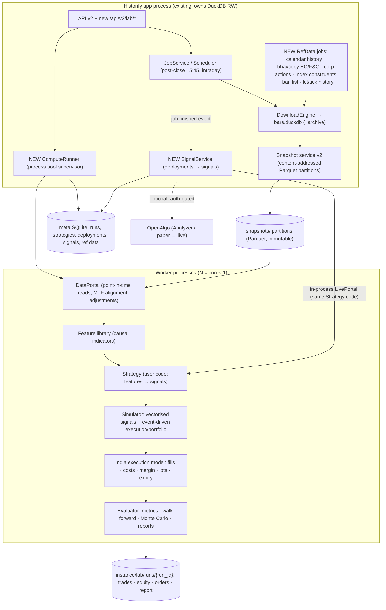
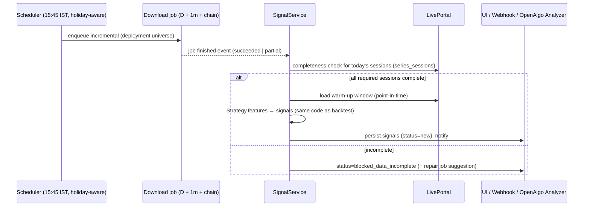

# Historify Lab: High-Level Design for Backtesting and Trading Signals (Indian Markets)

| | |
|---|---|
| **Document type** | Principal-engineer review + high-level design (pre-implementation). No application code was changed. |
| **Scope** | Add strategy backtesting and signal generation to Historify for NSE/BSE cash, index and stock F&O (NFO/BFO), with MCX/CDS as a later extension. |
| **Baseline reviewed** | `historify-master/historify` v2 (DuckDB bar store, SQLite meta, download engine, integrity ledger, roll-up, snapshots, scheduler). All prior reports are at the repo root. |
| **Evidence** | Findings marked **✅ Verified** were reproduced against the code in this sandbox. Findings marked **🔍 Static** come from reading the code. Items marked **🟡 Verify** need your live OpenAlgo + Angel One account. |

---

## Table of contents
1. [Executive summary](#1-executive-summary)
2. [Review: what Historify already gives a backtester, and what blocks it](#2-review-what-historify-already-gives-a-backtester-and-what-blocks-it)
3. [Requirements, goals and non-goals](#3-requirements-goals-and-non-goals)
4. [Target architecture](#4-target-architecture)
5. [Data layer for backtesting (point-in-time correctness)](#5-data-layer-for-backtesting-point-in-time-correctness)
6. [Multi-timeframe (MTF) design](#6-multi-timeframe-mtf-design)
7. [F&O data design](#7-fo-data-design)
8. [Feature library: moving averages (incl. WMA), trend, ratios](#8-feature-library-moving-averages-incl-wma-trend-ratios)
9. [Strategy API](#9-strategy-api)
10. [Simulation engine and the Indian-market execution model](#10-simulation-engine-and-the-indian-market-execution-model)
11. [Evaluation, validation and overfitting controls](#11-evaluation-validation-and-overfitting-controls)
12. [Live signal generation](#12-live-signal-generation)
13. [Persistence, API and UI](#13-persistence-api-and-ui)
14. [Non-functional requirements and testing](#14-non-functional-requirements-and-testing)
15. [Roadmap and effort](#15-roadmap-and-effort)
16. [Decisions needed and verification items](#16-decisions-needed-and-verification-items)
- [Appendix A: backtesting factor checklist (India)](#appendix-a-backtesting-factor-checklist-india)
- [Appendix B: cost model defaults](#appendix-b-cost-model-defaults)

---

## 1. Executive summary

**Historify is a strong foundation for a backtester, but it is a data platform, not yet a research platform.** It already has most of the hard parts:
- a checksummed, gap-aware store of 1m and daily bars;
- a session-anchored 1m → 3m…1h roll-up;
- immutable dataset snapshots;
- an exchange calendar;
- a durable job system.

Several data-correctness gaps would **silently bias backtest results**. They must be closed before any strategy result can be trusted.

### Blockers found (must fix first)
| # | Finding | Status | Impact on backtests |
|---|---|---|---|
| B1 | **The market calendar only has 2025 holidays.** It treats 2024 as 262 trading days (real NSE: about 250). Republic Day and Independence Day 2024 count as trading days. Saturday special sessions (20 Jan 2024, 18 May 2024, Budget day 1 Feb 2025) count as closed, so their bars would be **quarantined**. | ✅ Verified | Wrong bar counts, false gaps, lost special-session bars, wrong "N trading days" lookbacks, wrong expiry-day shifts. |
| B2 | **Bars are stamped at their *open* time, and daily bars at 00:00 IST.** A naive as-of join of D onto 1m attaches **today's official close to today's 09:15 bar**. The same trap exists for 5m → 1m and 1h → 15m joins. | ✅ Verified (`merge_asof` demo in §5.2) | Look-ahead bias. This is the most common reason a backtest looks great and then fails live. |
| B3 | **No corporate-action adjustment.** Revisions are *detected* (`probable_adjustment`), but nothing serves split- or bonus-adjusted series. | 🔍 Static | Fake −50% moves on split dates; broken moving averages and stops across corporate-action dates. |
| B4 | **F&O instrument metadata is incomplete.** On creation only `instrument_type` and `lot_size` are stored. `strike` is never populated, and there is no `underlying_id` or `option_type`. `expiry` is parsed from the symbol later. Lot size is stored as today's value only. | 🔍 Static (`web/api.py:346`, `provider/openalgo.py:250`) | Option chains can't be built. Historical P&L uses today's lot size, although lot sizes have changed several times. |
| B5 | **Intraday source defaults to `broker`.** The roll-up audit against real Angel One data has not been run yet. | 🔍 Static (`core/config.py`) | Multi-timeframe inconsistency: phantom stop-outs where a 15m high is never reached by any 1m bar. |
| B6 | **Process model.** DuckDB allows one read-write process, and the app holds it. `BackgroundRunner` runs one job at a time. | 🔍 Static | A backtester can't open `bars.duckdb` from another process. A 20-minute optimisation would block exports and maintenance. |
| B7 | **Expired F&O history is most likely not downloadable from the broker.** | 🟡 Verify | Index-options backtests need forward collection plus the NSE bhavcopy (EOD), or a paid vendor for intraday history. |

### Recommendation in one paragraph
Build **Historify Lab** as a new package inside the same repository (`app/lab/`). It has these parts:
- a **DataPortal** that serves *point-in-time* data (every value carries an `available_at`);
- a **feature library** of causal indicators (WMA/EMA/HMA, Supertrend, ADX, VWAP, CPR, RS, OI/PCR, IV…);
- a **hybrid simulator**: signals are computed vectorised, and execution, portfolio and margin are simulated event by event on 1m bars. An **Indian execution model** handles lots, ticks, circuits, MIS square-off, STT/charges, margins and expiry settlement;
- an **evaluation layer** with walk-forward analysis and overfitting controls;
- a **signal service** that runs the *same strategy code* after each scheduled data sync and publishes signals, plus optionally paper orders through OpenAlgo's Analyzer mode.

Backtests run in **separate worker processes** that read **immutable, content-addressed Parquet snapshots**. This solves the DuckDB lock and makes every run reproducible.

**Effort:** about **11–12 engineer-weeks** for equity + F&O backtesting and EOD/15m signals (§15). Real-time 1m/5m signals for a 200-symbol universe would need a WebSocket feed, which is a separate add-on.

---

## 2. Review: what Historify already gives a backtester, and what blocks it

### 2.1 Strengths to build on (keep, reuse, don't rebuild)
| Capability | Where | Why it matters for backtesting |
|---|---|---|
| Unified `ohlcv(instrument_id, interval_id, ts, o,h,l,c,v,oi)` in DuckDB, clustered by a monthly rewrite | `core/store/duckdb_store.py` | Fast full-series loads: 10 years of 1m for one symbol in 138 ms, and 50 symbols × 1 year in 4.9 s (measured at 10 GB). |
| Session-anchored roll-up 1m → 3m…1h, with W/M derived from D | `core/rollup.py` | Multi-timeframe consistency by construction. Buckets anchor at 09:15, like the broker's. |
| Session ledger (complete / short / missing / confirmed / provisional) + revision events with archived old values | `core/integrity/*`, `SeriesSession`, `RevisionEvent` | The backtester can **refuse or flag** incomplete sessions instead of silently trading through them. |
| Immutable snapshots (Parquet + manifest + sha256) | `core/snapshots.py` | Reproducibility. Every run can pin its dataset. |
| Provenance on every series (`broker` / `derived_from_1m` / `derived_from_D`) | `core/rollup.py::provenance` | A backtest can refuse mixed-provenance inputs. |
| Exchange calendar with per-exchange sessions, MCX DST close and DB overrides | `core/calendar.py` | The basis for trading-day arithmetic, expiry shifts and MIS square-off. It needs history (B1). |
| Durable jobs + scheduler (post-close 15:45, holiday-aware, catch-up) | `core/jobs/*`, `core/scheduling/*` | A natural trigger for EOD signal runs. |
| Archive of expired F&O, transparently readable | `_src` UNION over `arch.ohlcv` | Expired contracts collected going forward stay backtestable. |
| Test culture: hypothesis property tests, mock broker, time-travel clock, 293 tests, 92% core coverage | `tests/` | Reuse for look-ahead property tests and golden trade tests. |

### 2.2 Gaps (detail for the blockers in §1)

**B1: calendar history.** ✅ Verified. `market_calendar.json` is labelled `"2025.1-sample"` and lists only 2025 equity holidays:
```
2024-01-26 trading          <- Republic Day, market closed
2024-08-15 trading          <- Independence Day, market closed
2024-01-20 Sat None         <- NSE special live session, treated as closed -> bars quarantined
2025-02-01 Sat None         <- Budget day full session, treated as closed
2024 trading days per calendar: 262  (actual NSE ~250)
Muhurat 2024-11-01 session: 09:15-15:30   <- actually a holiday with an evening Muhurat session
```
- **Fix:** ship a versioned holiday and special-session history for 2010 → current year for NSE, BSE and MCX, with Muhurat sessions as overrides.
- **Test:** for every year, calendar trading days must equal the count of distinct dates in the NSE bhavcopy archive for that year.

**B2: look-ahead through the bar-open timestamp convention.** ✅ Verified. See §5.2. The store convention is correct for storage. What's missing is an explicit **`available_at`** rule in the read path for research.

**B3: corporate actions.**
- The revision detector only fires if the broker *re-delivers* adjusted history. Whether Angel One adjusts daily and intraday history is 🟡 unverified.
- Either way, backtests need raw prices for P&L and adjusted prices for indicators (§5.4).

**B4: instrument model.**
- `_get_or_create_instrument` stores only `name`, `instrument_type` and `lot_size`.
- `OpenAlgoProvider.search()` returns `expiry` and `strike`, but `symbol()` does not, so nothing persists them.
- Options need `underlying`, `option_type (CE/PE)`, `strike`, `expiry`, plus **time-versioned** `lot_size`, `tick_size` and `freeze_qty`.

**B5: roll-up audit pending.**
- Backtests should run on `rollup_1m` data: 1m as the single source of truth, D from the broker.
- The audit (`flask historify rollup-audit`) must run against the real account first.

**B6: process and concurrency model.**
- `DuckDBBarStore` opens the file read-write. A second process cannot open it, even read-only (`StoreLockedError`).
- `BackgroundRunner.KINDS` run serially in one thread.
- CPU-heavy simulations inside the Flask process would also compete for the GIL with API threads. The p95 budget is < 300 ms.

**B7: F&O history depth.**
- Indian broker APIs generally serve history only for *currently listed* contracts, and Angel One's scrip master drops expired tokens. 🟡 Verify.
- Historify's 30-day archive rule keeps what it collected. It cannot recover what was never collected.
- This is the single most important factor in scoping options backtests (§7.1).

**Smaller observations**
- The default backfill for 1m is 30 days (`DEFAULT_BACKFILL_DAYS`). Backtest datasets need an explicit deep-backfill job per universe. The planner already supports `mode=fresh` with `start`.
- Snapshots **materialise** rolled-up intervals and copy everything per snapshot. 200 symbols × 10 years of 1m is about 2.5 GB per snapshot. Too heavy to create one per backtest run (§5.1 proposes content-addressed partitions).
- Live following is capped at 5 series (`follow_max_series`) and relies on REST polling. That is fine for charts, but not a universe-wide intraday signal feed (§12.3).
- Historify has **no authentication** (`SECURITY.md`). It must not place broker orders until auth exists (§12.4).

---

## 3. Requirements, goals and non-goals

### 3.1 Functional
1. Backtest **equity cash** strategies (positional on D, intraday on 1m–1h) on a universe: a watchlist, or point-in-time index membership.
2. Backtest **futures** (stock and index, continuous with rolls) and **options** (single-leg and multi-leg: spreads, straddles, strangles, iron condors), with expiry handling.
3. **Multi-timeframe** strategies, for example a daily regime filter, a 1h trend, a 15m signal and 1m execution.
4. A causal **feature library**: WMA/EMA/SMA/HMA/VWMA, VWAP, Supertrend, ADX, RSI, MACD, ATR, Bollinger, CPR/pivots, ORB, relative strength, breadth, OI/PCR/basis/IV.
5. Realistic **Indian execution and costs**: lots, tick rounding, circuits, MIS square-off, STT and charges, slippage, margin, physical settlement.
6. **Evaluation:** standard metrics, benchmark comparison, walk-forward, parameter sweeps, Monte Carlo, a regime breakdown.
7. **Signals:** run deployed strategies after data syncs (EOD and ≥15m intraday), persist and show the signals, and optionally send them to OpenAlgo (Analyzer/paper first).
8. **Reproducibility:** every run records its dataset fingerprint, code hash, parameters, cost-model version and calendar version. A re-run gives identical trades.

### 3.2 Non-goals (v1)
- Tick-level or order-book simulation. Historify has no bid/ask or depth history; spreads are modelled (§10.3).
- HFT or sub-minute strategies.
- Fundamental-data ingestion. The feature store accepts point-in-time fundamentals later (§8.5).
- Automatic live order placement without a human-enabled, authenticated bridge.

---

## 4. Target architecture


<details><summary>Mermaid source</summary>


</details>

### 4.1 Components
| Component | Responsibility | Lives in |
|---|---|---|
| **RefData jobs** | Ingest and version reference data: holiday history, NSE equity bhavcopy (incl. delivery %), F&O bhavcopy (settle price, OI, contracts), corporate actions, index constituents, F&O ban list, lot/tick history, INDIAVIX, risk-free rate. | `app/core/refdata/` (new), runs as `BackgroundRunner` kinds |
| **Snapshot v2** | Immutable, content-addressed Parquet partitions per `(instrument, interval, year)`. A snapshot is a manifest that *references* partitions, so runs can share data without copying it. | extend `core/snapshots.py` |
| **DataPortal** | One interface for loading bars, corporate-action-adjusted views, MTF alignment with `available_at`, reference data and completeness masks. Two backends: `SnapshotPortal` (workers) and `LivePortal` (in-process BarStore, used by signals). | `app/lab/data/` |
| **Feature library** | Pure, causal, vectorised indicators with declared warm-up. Batch and incremental implementations are parity-tested. | `app/lab/features/` |
| **Strategy API** | User strategy classes: declare universe, timeframes, parameters and warm-up; produce features → signals → orders. | `app/lab/strategy.py`, user strategies in `strategies/` |
| **Simulator** | Vectorised signal pass, then an event-driven execution and portfolio loop over timestamps where something happens. | `app/lab/sim/` |
| **India execution model** | Fill rules, slippage, circuit locks, MIS square-off, lots, ticks, cost schedule, margin, expiry and settlement. | `app/lab/market/` |
| **Evaluator** | Metrics, benchmark, walk-forward, sweeps, Monte Carlo, regime reports. | `app/lab/eval/` |
| **ComputeRunner** | Job kinds `backtest`, `sweep` and `walk_forward` on a `ProcessPoolExecutor` (spawn), with progress and cancellation through the `jobs` table. Separate from `BackgroundRunner`, so exports and maintenance are never blocked. | `app/lab/runner.py` |
| **SignalService** | Deployments (strategy + params + universe + schedule). Runs after the data job for its schedule finishes, checks data completeness, persists signals and optionally forwards them. | `app/lab/signals.py` |

### 4.2 Process model (resolves B6)
- **Workers never open `bars.duckdb`.** They read snapshot partitions, which are plain Parquet. DuckDB in a worker reads them through `read_parquet()` with partition pruning.
- **Each run pins a snapshot.**
  - In "Quick run" mode the system creates or reuses an **auto snapshot**. Content addressing makes this cheap, because unchanged partitions are reused.
  - A run on "latest data" therefore costs only the partitions that changed since the last snapshot, usually just the current month.
- Workers write their artefacts (Parquet/JSON) to `instance/lab/runs/<run_id>/`. Run status goes to meta SQLite (WAL, short transactions).
- **Live signals use `LivePortal`** inside the app process, reading through the existing `BarStore`. Signal runs are small (one day per symbol), so the GIL impact is negligible. Heavy runs never happen in-process.
- **Maintenance** (rewrite-compaction) needs exclusive access to `bars.duckdb`, not to the snapshots. Backtests keep running during maintenance.

---

## 5. Data layer for backtesting (point-in-time correctness)

### 5.1 Snapshot v2: content-addressed partitions
- **Partition** = one `(instrument_id, interval ∈ {1m, D}, year)` Parquet file.
  - Its id is `sha256(rows)`, which the session-ledger checksums already make cheap to compute.
  - Stored once under `instance/lab/partitions/<sha>.parquet`.
- **Snapshot manifest** = a list of partition ids + reference-data versions + calendar version + `intraday_source`.
  - Adds no bytes when nothing changed.
  - Stays immutable and verifiable, like today.
- **Only 1m and D are stored.** 3m…1h, W and M are rolled up inside the worker using the **same** `rollup_frame` / `resample_frame` code as the app. The backtest and the chart therefore can never disagree.
- **Garbage collection:** delete a partition when no snapshot references it and it is older than N days.
- **Size for your profile** (200 symbols, 1m for 10 years): about 2.5 GB once. Each further snapshot adds only the changed partitions, typically about 20 MB per month.

### 5.2 Time semantics: `ts` vs `available_at` (resolves B2)
The store keeps `ts = bar open`. The DataPortal adds **`available_at`** to every row and **only ever joins on it**:

| Series | `ts` (stored) | `available_at` (research) | Notes |
|---|---|---|---|
| Intraday bar, length L (1m…1h; broker or rolled up) | bar open | `ts + L` (+ `signal_latency`, default 0 in research and 60 s to mirror live finality) | The last bar of the session may be partial (for example 15:15–15:30 for 1h). It is available at session close. |
| Daily D (broker, official close) | 00:00 IST of the trading date | session close + publication lag (default **15:30 + 15 min**, matching the 15:45 post-close run) | Today's D may never be used on the same day before the close. For "trade at close" logic, see §10.2. |
| W / M | first trading day of the period | close of the **last** trading day of the period | A partial week or month is never joined. |
| Bhavcopy extras (delivery %, settle price, EOD OI) | trade date | that evening (default 20:00 IST) → usable next session | |
| Corporate action | ex-date | announcement date (for event strategies); price adjustment is applied as described in §5.4 | |
| Index constituent change | effective date | announcement date | |
| Fundamentals (future) | period end | **results announcement timestamp** | |

✅ **Demonstration of the trap** (today's close leaking into the morning), using the repo's own timestamp functions:
```
D bar ts (2025-03-28): 2025-03-28 00:00+05:30        close_D = 105 (known only after 15:30)
1m bar ts 09:15      : 2025-03-28 09:15+05:30
merge_asof(1m, D, on='ts') -> the 09:15 bar gets close_D = 105   ← look-ahead
```
The DataPortal's `align(higher_tf, to=lower_tf)` performs `merge_asof(left_on=decision_time, right_on=available_at, allow_exact_matches=True)`, where `decision_time = ts + L` of the lower-timeframe bar. This rule is enforced in the library, and the look-ahead property test in §14.2 proves it.

### 5.3 Completeness and provenance gates
For every `(instrument, interval, session)` it reads, the DataPortal returns a **quality mask** taken from `series_sessions`. Per run, the user picks a policy:
- `strict`: fail the run if any required session is `short` or `missing`. This is the default for signals.
- `skip_day`: no new entries on that instrument for that session; existing positions are marked to the last known price.
- `warn`: trade through it, and list the affected sessions in the report.

A run also **refuses mixed provenance** by default, for example broker 15m in one year and rolled-up 15m in another.

### 5.4 Corporate actions (resolves B3)
- **New table** `corporate_actions(instrument_id, ex_date, kind ∈ {split, bonus, rights, dividend, demerger, merger, symbol_change, delisting}, ratio_num, ratio_den, cash, announced_at, source)`.
  - Sources: NSE corporate-actions file, cross-checked against `RevisionEvent.probable_adjustment` factors that Historify already detects.
- **Two views from the DataPortal:**
  - **Adjusted (backward, multiplicative)** for indicators, signals and chart overlays. Volume is adjusted by the inverse factor.
  - **Raw** for fills, P&L, lot sizes, tick rounding, circuit bands and absolute price filters ("price > ₹50").
  - Mixing the two views up is a classic bug, so the Strategy API exposes them as separate, named frames.
- **Dividends:** optional total-return adjustment for long-horizon equity strategies. The benchmark should be **NIFTY 50 TRI**, not the price index.
- **Demergers / symbol changes:**
  - Map old and new symbols to one `security_id` (ISIN-based), so history is continuous.
  - Demergers (for example a special pre-open price-discovery session) get a manual adjustment factor.
- **F&O:** the exchange adjusts strikes and lot sizes of open contracts on corporate actions. Store the adjusted contract terms in `instrument_terms_history` (§7.2).

### 5.5 Universe and survivorship bias
- **Point-in-time index membership:** `index_constituents(index, instrument_id, effective_from, effective_to)` for NIFTY 50 / 100 / 200 / 500, Bank NIFTY and sector indices. Sources are NSE index reconstitution notices (semi-annual) and their archives.
- **A universe is a function of date.** `Universe("NIFTY200", pit=True)` yields different members on different dates, and a stock enters the backtest only while it is a member.
- **Never purge delisted or inactive instruments.** This is already the policy. Their history must stay loadable, or the backtest is survivorship-biased.
- **F&O eligibility** also changes over time: stocks enter and exit the F&O segment. Keep `fno_eligibility(instrument_id, from, to)` for futures and options universes.

### 5.6 Reference data summary
| Data | Source | Cadence | Used for |
|---|---|---|---|
| Holidays + special sessions (2010→) | NSE/BSE/MCX circulars | yearly + ad hoc | trading-day maths, expiry shift, MIS square-off time, completeness |
| Equity bhavcopy (OHLC, official close, **delivery qty / %**) | NSE archives (handle both the legacy and the **UDiFF** format introduced in 2024) | daily, evening | D reconciliation (I-7), delivery-% features |
| F&O bhavcopy (OHLC, **settle price, OI, ΔOI**, contracts, turnover) | NSE / BSE archives | daily, evening | EOD options chains, expired-contract history, PCR, max pain, OI build-up |
| Corporate actions | NSE | daily | adjustments |
| Index constituents | NSE indices | on change | PIT universes |
| F&O ban list (MWPL > 95%) | NSE | daily | no new positions in banned stocks |
| Lot size / tick size / freeze qty history | NSE contract master + circulars | on change | sizing, rounding, order slicing |
| INDIAVIX | OpenAlgo `NSE_INDEX` (already downloadable as an instrument) | with bars | regime filter, IV context |
| Risk-free rate (91-day T-bill) | RBI (manual or CSV import) | weekly | Sharpe, option pricing |

- **Implementation note:** reference time series (INDIAVIX, risk-free rate, breadth) are stored as **instruments on a synthetic `REF` exchange** in the existing `ohlcv` table. Snapshots, charts and the DataPortal then handle them for free.
- Fetch from NSE politely: rate-limited, cached, and within the site's terms of use.

---

## 6. Multi-timeframe (MTF) design

### 6.1 Rules
1. **One base clock per run**, usually the execution timeframe (1m or the signal timeframe).
2. **Every higher timeframe is derived from the same 1m series** (`rollup_1m`), except D, which comes from the broker (official close). This is the hybrid already recommended in `ROLLUP_RECOMMENDATION_FOR_BACKTESTING.md`.
3. **Higher-timeframe values are aligned on `available_at`** (§5.2). A 1h trend value becomes visible at 10:15 for the 09:15–10:15 bar, not at 09:15.
4. **"Forming" bars are opt-in and explicit.** Some strategies want the developing daily high/low ("day-so-far"). The DataPortal provides `forming("D")`, computed from 1m bars up to the decision time. It never uses the official D bar, which doesn't exist yet at that point.
5. **Warm-up** is declared per timeframe (for example `{"D": 200, "1h": 50, "15m": 34}`). The loader fetches `start − warmup` bars and the simulator starts trading at `start`.
6. **Session boundaries:** indicators that reset each day (VWAP, ORB, CPR) key on the **trading date from the calendar**, not on the clock date. That handles MCX's evening session correctly.
7. **Partial-bar awareness:** the last 1h bar (15:15–15:30) and the last 30m bar are shorter. Range-based indicators (ATR) can optionally exclude or normalise partial bars.

### 6.2 Typical MTF pattern
| Role | TF | Example |
|---|---|---|
| Regime | D | NIFTY 50 above its 200-day SMA; INDIAVIX < 20 |
| Trend | 1h | WMA(20) > WMA(50), ADX(14) > 20, Supertrend(10, 3) up |
| Setup / signal | 15m | pullback to EMA(20) plus an RSI(14) cross up from 40 |
| Execution / risk | 1m | entry on the next 1m open; stop = 1.5 × ATR(15m); intrabar stop checks on 1m |

### 6.3 Intrabar ambiguity
When a single 1m bar touches both the stop and the target, the simulator uses a **configurable, conservative default**: the stop is filled first. It also reports how many trades were ambiguous. If that share is material, the strategy is too sensitive to bar resolution.

---

## 7. F&O data design

### 7.1 Data availability reality and sourcing (B7)
| Need | Broker (OpenAlgo → Angel One) | NSE bhavcopy (free, EOD) | Paid vendor |
|---|---|---|---|
| Active futures/options, 1m | ✅ while listed | — | ✅ |
| **Expired** contracts, 1m | ❌ most likely (🟡 verify) | — | ✅ (intraday options history) |
| Expired contracts, **daily** OHLC + settle price + OI | ❌ | ✅ years of history | ✅ |
| Intraday OI | 🟡 verify whether OpenAlgo's Angel adapter fills `oi` in history | — | ✅ |
| Bid/ask, depth | live quotes only | — | some vendors |

**Recommended sourcing strategy**
1. **Start forward collection now.**
   - A scheduled job downloads 1m bars for a **bounded option chain**: NIFTY and your chosen underlyings, the nearest 2 expiries, ATM ±15 strikes, CE + PE.
   - It also downloads the front two futures every day post-close.
   - Each month of delay is a month of intraday options history you can never get back for free.
2. **Backfill EOD history from the F&O bhavcopy** for every contract, years back. This supports EOD options strategies (for example weekly short strangles that are managed daily), PCR/OI studies and futures-basis studies.
3. **Paid intraday history** (optional): needed only if you want intraday options backtests over periods before forward collection started. The DataPortal treats it as another provenance (`vendor_x`).

**Sizing of forward collection**
- One underlying: 31 strikes × 2 (CE/PE) × 2 expiries = **124 contracts**.
- Bars: 124 × 375 × 250 ≈ 11.6 M bars per year, about **150 MB per year** at the measured ~13 B per bar.
- Requests: about 124 requests per day post-close, which is about 3% of the hourly budget.
- Ten underlyings ≈ 1.5 GB per year. That is comfortable within the 10 GB headroom shown in the storage report.

### 7.2 Instrument model (resolves B4)
- **Extend `instruments`** with `underlying_id`, `option_type (CE|PE|FUT|null)`, `segment`, `isin`, `security_id`, and populate `strike` and `expiry` from the broker master or the bhavcopy.
- **Add `instrument_terms_history(instrument_id, effective_from, effective_to, lot_size, tick_size, freeze_qty, price_band)`.** P&L and sizing always use the terms valid on the trade date.
- **Add `expiries(underlying_id, expiry_date, kind ∈ {weekly, monthly}, settlement ∈ {cash, physical})`**, taken from the contract master or bhavcopy, **never computed from a weekday rule**.
  - Expiry weekdays have changed several times (index by index, and again with the 2025 NSE move to Tuesday expiries; 🟡 verify dates).
  - Expiries move to the previous trading day when they fall on a holiday.
  - SEBI's Nov 2024 rules cut weekly expiries to one benchmark index per exchange.

### 7.3 Continuous futures and rolls
- **Roll rule** per strategy: `N` trading days before expiry, on open-interest crossover, or at expiry. Default: roll at the close, 2 trading days before expiry.
- **Two series:**
  - **Back-adjusted** (difference or ratio) continuous series for indicators.
  - **Actual contract** prices for fills and P&L. Each roll is executed as two trades with full costs.
- Store a `roll_calendar` per continuous series in the run artefacts, so rolls are auditable.

### 7.4 Options chain representation
- **Chain view:** `chain(underlying, as_of, expiry) → DataFrame[strike, CE/PE, o,h,l,c,v,oi, iv, delta, gamma, theta, vega]`, aligned on `available_at`.
- **Strike selection helpers:**
  - `atm(underlying_price, step)`;
  - `by_delta(0.25)`;
  - `by_premium(≈₹50)`;
  - `otm(n)`.
  - Strike steps are per underlying and versioned.
- **Greeks / IV:**
  - Computed in a **post-close job** per option bar (Black-76 on the same-expiry future, or Black-Scholes with a dividend yield), and materialised in `fno_analytics`, because millions of IV solves are too slow to redo on every run.
  - Intraday IV uses the synchronous futures price from the same minute. Never mix the spot index close with an option's last trade from a different time.
- **Liquidity filter:** strikes with zero volume in a bar have stale prices. The simulator refuses fills on bars with `volume == 0` for options (configurable) and reports how often this happened.

### 7.5 Derived F&O analytics (features)
| Feature | Definition / note | Data |
|---|---|---|
| PCR (OI, volume) | ΣPut OI / ΣCall OI, per expiry or across expiries | chain EOD / intraday |
| OI build-up class | price ↑ + OI ↑ = long build-up; ↓ + ↑ = short build-up; ↑ + ↓ = short covering; ↓ + ↓ = long unwinding | futures bars + OI |
| Max pain | strike minimising total option-writer payout | chain |
| Basis / premium | (Fut − Spot) / Spot, annualised cost of carry | futures + spot |
| Rollover % / cost | next-month OI / (near + next) in expiry week | bhavcopy |
| IV, IV rank / percentile | ATM IV vs its trailing 252-day range | `fno_analytics` |
| Skew | IV(25Δ put) − IV(25Δ call) | `fno_analytics` |
| OI concentration | highest call/put OI strikes as resistance/support | chain |
| INDIAVIX regime | level, and change vs 20-day average | REF instrument |

### 7.6 F&O regime changes to segment backtests by
Backtests across these dates must be **reported per regime**. Results before and after a change are not comparable.
- **Lot-size revisions** (periodic): handled by `instrument_terms_history`.
- **SEBI F&O framework (from 20 Nov 2024):**
  - higher minimum contract value (lot sizes rose);
  - one weekly expiry per exchange;
  - +2% ELM on short options on expiry day.
- **From Feb 2025:**
  - upfront premium collection;
  - no calendar-spread margin benefit on expiry day.
- **STT increases on F&O from 1 Oct 2024.** Handled by the versioned cost schedule (Appendix B).
- **Expiry weekday changes** (2023–2025, per index): handled by the `expiries` table.
- **Physical settlement of stock F&O** (since 2019): ITM stock options held into expiry create delivery obligations and STT on intrinsic value (§10.4).

---

## 8. Feature library: moving averages (incl. WMA), trend, ratios

### 8.1 Design rules (apply to every indicator)
1. **Causal:** the value at bar *t* uses only bars ≤ *t*. Enforced by the look-ahead property test (§14.2).
2. **Declared warm-up:** every indicator exposes `warmup(params)`. Values before warm-up are `NaN` and can never trigger signals.
3. **Same code for backtest and live:** indicators are pure functions over arrays. A batch implementation (vectorised numpy) and an incremental one (for live updates) are tested for parity to 1e-9.
4. **Deterministic NaN and gap handling:** no forward-filling across sessions unless the indicator defines it. The quality mask (§5.3) propagates.
5. **Adjusted inputs by default:** price indicators read the corporate-action-adjusted view (§5.4). VWAP and session indicators use raw intraday data, because intraday sessions don't cross ex-dates.
6. **Reference values:** unit tests compare against hand-computed fixtures and, in dev only, TA-Lib or pandas-ta outputs. Neither becomes a runtime dependency; mind AGPL compatibility in `requirements.in`.

### 8.2 Moving averages and trend
| Indicator | Definition / India-specific note |
|---|---|
| SMA(n) | mean of the last n closes |
| EMA(n) | α = 2 / (n+1). Seeded by the SMA of the first n bars; the seed choice is documented, because it changes early values. |
| **WMA(n)** | Σ(wᵢ·pᵢ) / Σwᵢ with wᵢ = 1..n (newest = n). Reacts faster than SMA with less noise than EMA. |
| **HMA(n)** | WMA(2·WMA(n/2) − WMA(n), √n). A low-lag trend line built on WMA. |
| VWMA(n) | Σ(p·v) / Σv over n bars |
| **VWAP (session-anchored)** | resets at each session open from the calendar (09:15 NSE, 09:00 MCX), cumulative Σ(typical·v) / Σv |
| **Supertrend(ATR n, mult)** | very widely used in Indian intraday trading; direction flips on ATR-band breaks |
| ADX / DMI(14) | trend strength; trending if ADX > 20–25 |
| MACD(12, 26, 9) | EMA difference + signal line |
| Ichimoku, Donchian, Parabolic SAR | trend structure and breakouts |
| Linear-regression slope / t-stat(n) | a statistically defined trend |
| MA stack | EMA20 > EMA50 > EMA200: trend alignment |
| **Trend score (MTF)** | per timeframe: +1 / 0 / −1 from (price vs MA, MA slope, ADX). Summed across D/1h/15m to give an "alignment" value from −3 to +3. |

### 8.3 Momentum, volatility, volume, structure
- **Momentum:** RSI, Stochastic, ROC, CCI, Williams %R.
- **Volatility:** ATR, ATR%, Bollinger (+ bandwidth squeeze), Keltner, historical volatility (close-to-close and Parkinson), INDIAVIX.
- **Volume:** OBV, volume ratio (v / SMA20(v)), **delivery % and its change** (from the NSE bhavcopy; a strong India-specific accumulation signal), VWAP deviation.
- **Structure (popular in Indian markets):**
  - **CPR** (central pivot range) and its width;
  - classic and Camarilla pivots;
  - previous day high / low / close (using the official close);
  - **opening range breakout** (first 5 / 15 / 30 minutes from 09:15);
  - gap % vs the previous official close;
  - 52-week high / low distance.

### 8.4 Ratios
| Class | Examples | Notes |
|---|---|---|
| Technical ratios | price / MA distance, ATR%, volume ratio, delivery % | per instrument |
| **Relative strength** | stock / NIFTY 50 (or sector index) ratio, RS rank across the universe, Mansfield RS, rolling beta | needs index series (already downloadable as `NSE_INDEX`) |
| **Breadth** | advance/decline ratio, % of the universe above the 50/200 DMA, new highs − new lows | computed across the PIT universe, stored as REF series |
| F&O ratios | PCR, OI change ratio, basis %, rollover %, IV percentile, skew | §7.5 |
| Fundamental ratios (later) | P/E, P/B, ROE, D/E, earnings growth | **Point-in-time only**: keyed by the results-announcement timestamp; restated values must never overwrite history. No source in Historify today. |
| Performance ratios | Sharpe, Sortino, Calmar, profit factor, Omega, Ulcer | §11 |

### 8.5 Feature store (caching)
- **Compute on the fly by default.** A vectorised WMA over 1 M bars takes milliseconds, and caching adds complexity.
- **Materialise only expensive or cross-sectional features:** IV/Greeks, breadth, RS ranks. Cache key = `(feature, params, snapshot partition ids)`, so the cache is invalidated automatically when data changes.

---

## 9. Strategy API

Strategies are plain Python classes, versioned by a content hash of their source file. The API separates **vectorised decision logic** from **event-driven execution**, so sweeps are fast and fills stay realistic.

```python
from app.lab import Strategy, Universe, tf, features as F, Order

class WmaTrendPullback(Strategy):
    name = "wma_trend_pullback"
    universe = Universe.index("NIFTY200", point_in_time=True)       # or Universe.watchlist("Swing")
    timeframes = {"regime": "D", "trend": "1h", "signal": "15m", "exec": "1m"}
    params = {"fast": 20, "slow": 50, "atr_mult": 1.5, "risk_pct": 0.5}
    product = "MIS"                                                 # MIS | CNC | NRML
    warmup = {"D": 200, "1h": 60, "15m": 40}

    def features(self, d):                      # d: DataPortal view; every join is on available_at
        reg = d.index("NIFTY 50", "D")
        trend = d.bars("1h")                    # adjusted view by default; d.raw("1h") for price filters
        sig = d.bars("15m")
        return {
            "regime_ok": d.align(reg.close > F.sma(reg.close, 200), to="signal"),
            "trend_up":  d.align((F.wma(trend.close, self.p.fast) > F.wma(trend.close, self.p.slow))
                                 & (F.adx(trend, 14) > 20), to="signal"),
            "pullback":  F.cross_up(F.rsi(sig.close, 14), 40) & (sig.low <= F.ema(sig.close, 20)),
            "atr":       F.atr(sig, 14),
        }

    def signals(self, f):                       # vectorised; returns entries/exits per instrument x bar
        entry = f.regime_ok & f.trend_up & f.pullback
        return self.enter_long(entry, stop=lambda px: px - self.p.atr_mult * f.atr,
                               size=self.risk_sizing(self.p.risk_pct), exit_at="15:10")

    # optional event hooks for path-dependent logic (trailing stops, scaling, option adjustments)
    def on_fill(self, ctx, fill): ...
    def on_bar(self, ctx, bar): ...
```

- **Options strategies** use the same class plus chain helpers, for example `self.sell(chain.by_delta(0.2, "CE"))` and `self.sell(chain.by_delta(0.2, "PE"))` as a **basket** (multi-leg, margin computed as a basket).
- **Parameters** have a schema (type, range, step), so the sweep UI and the API can validate them.
- **Sandboxing:** strategy code is trusted local code; it's your machine. It runs only in worker processes, and is never uploaded through the web API in v1. Strategies live in `instance/strategies/`, or a git repo path configured in Settings.

---

## 10. Simulation engine and the Indian-market execution model

### 10.1 Hybrid engine
| Stage | How | Why |
|---|---|---|
| 1. Features + signals | vectorised over the full panel (numpy/pandas) | fast sweeps; a WMA over 10 years of 1m bars takes milliseconds |
| 2. Execution / portfolio | **event-driven loop only over timestamps with signals, open positions or scheduled events** (square-off, expiry, roll), using 1m bars for fills and stops | path-dependent realism (stops, capital, margin, lots) without iterating over every 1m bar of 200 symbols in Python |
| 3. Accounting | daily MTM at the official close; intraday MTM on 1m | equity curve and drawdowns |

**Build vs adopt**
- Existing engines don't model NSE lots, STT, MIS, circuits, expiries or calendars. Their licences also need care against AGPL-3.0 (for example `vectorbt` is Apache-2.0 + Commons Clause).
- A **thin in-house engine** (about 2–3k lines) on top of Historify's own data types is less work than adapting one, and it stays fully auditable.
- `backtesting.py` (AGPL-3.0) remains fine for throwaway single-symbol prototyping on snapshot Parquet files.

**Performance budgets**
| Run | Budget |
|---|---|
| 1 symbol × 10 years of D | < 1 s |
| 1 symbol × 1 year of 1m, MTF | < 3 s |
| 200 symbols × 10 years of D | < 15 s |
| 200 symbols × 1 year of 15m with 1m execution | < 90 s |
| 500-combination sweep | parallel across worker processes; results stream into the run group |

### 10.2 Order and fill rules
| Situation | Rule (default, configurable) |
|---|---|
| Signal on bar *t* (closes at `ts+L`) | Fill at the **next bar's open** (`t+1`) + slippage. Never at bar *t*'s close, unless the strategy explicitly models that (next row). |
| "Trade at close" (daily strategies) | Option A: decide on the 15:25 1m data and fill at the 15:25–15:29 VWAP. Option B (NSE cash only): fill at the **official close** in the post-close session (15:40–16:00). That session has limited liquidity, so cap participation. Never "decide on the official close and fill at it". |
| Market order at the open | Fill at the open of the first 1m bar (09:15). The open is the pre-open auction price, so expect a gap. |
| Stop / stop-limit | Triggered when the 1m high/low crosses. **Gap-through:** fill at the bar open if it is beyond the stop. |
| Limit | Fill only if the price trades **through** the limit (configurable: touch vs through). |
| Both stop and target in one 1m bar | Stop first (conservative); report the count (§6.3). |
| **Circuit lock** | If the bar is flat at the upper/lower band (`h == l` at the band price for ≥ N minutes), **no fill on the locked side**. Bands are 2/5/10/20% for non-F&O stocks, from `instrument_terms_history`. |
| Zero-volume bar | No fill (illiquid options and small caps). |
| Participation cap | fill qty ≤ x% of bar volume (default 5%); the remainder continues or is cancelled |
| Lot / tick | Quantity is rounded down to lots (F&O) or to shares; prices are rounded to `tick_size` as of that date. |
| Freeze quantity | Orders above the freeze limit are split into slices; each slice is a separate order for costs. |
| F&O ban | No new positions in banned stocks; reducing positions is allowed. |

### 10.3 Slippage and spread
Historify has no bid/ask history, so slippage is **modelled**:
- **Equities and futures:** `max(k_ticks × tick, bps × price)`, with separate defaults for large, mid and small caps and a higher value at the open and the close.
- **Options:** a spread model based on premium and moneyness, for example `max(1 tick, a + b × premium)` with wider values for far OTM strikes and on expiry day.
- **Calibration loop:** the QuoteService already polls quotes. Add an opt-in job that samples **depth snapshots** (best bid/ask) for the chain during market hours. Fit the spread model from real spreads and publish the fitted parameters as a versioned `slippage_model`.
- **Sensitivity:** every report shows results at 1×, 2× and 3× slippage. A strategy that survives only at 1× is not robust.

### 10.4 Products, margin, settlement
| Product | Rules in the simulator |
|---|---|
| **CNC (delivery)** | Long only. T+1 settlement: sale proceeds are usable per broker rules (configurable). DP charge per scrip per sell day. |
| **MIS (intraday)** | Leverage per broker (about 5× for equity, configurable). **Auto square-off** at the broker's cut-off (default 15:15 equity; configurable per exchange, MCX later). Shorting is allowed intraday only. |
| **NRML (F&O carry)** | Margin = SPAN + exposure. v1 uses a **margin approximation**: % of notional per underlying for futures and short options, and the premium for long options. v2 parses **NSE SPAN risk-parameter files** for exact margins. Extra ELM on expiry day after Nov 2024. |
| **Equity shorts overnight** | **Not allowed** in cash (only via SLB, out of scope). The simulator rejects them; use futures. |
| **Expiry: index options** | Cash-settled at the exchange settlement price. ITM long options are exercised automatically, with **STT on intrinsic value**. |
| **Expiry: stock F&O** | **Physically settled.** Held ITM into expiry → delivery obligation with higher margins in expiry week. The default strategy behaviour is to close before expiry-week margin escalation; holding through it is simulated explicitly if the user chooses. |
| Capital constraint | Orders that would exceed the available margin are rejected and logged. No negative cash unless leverage is configured. |

### 10.5 Costs
- A **versioned cost schedule**, keyed by `effective_from` and product. Defaults are in Appendix B.
- The schedule covers brokerage, STT/CTT, exchange transaction charges, the SEBI fee, stamp duty, GST, DP charges and IPFT.
- A run records the schedule version it used. Reports show gross, costs and net. Cost drag is reported as % of gross P&L and per trade.
- **Validation:** a unit test reproduces a real Angel One contract note (you provide one) to the paisa.

### 10.6 Latency modelling for signal parity
- **Research default:** a decision at `ts+L`, and a fill on the next bar.
- **Live-parity mode:** adds the **real signal latency** of the live pipeline (§12.3), for example 60 s of finality + fetch time. An intraday strategy that only works with zero latency will show it here, before it loses money.

---

## 11. Evaluation, validation and overfitting controls

### 11.1 Metrics (per run, per year, per regime, per instrument)
- **Returns:** CAGR, total return, monthly returns heatmap, rolling 1-year return.
- **Risk:** volatility, **max drawdown** (depth and duration), time to recovery, Ulcer index, worst day/week, exposure %.
- **Ratios:** Sharpe (risk-free = 91-day T-bill series, not 0), Sortino, Calmar, Omega, information ratio vs the benchmark.
- **Trades:** count, win rate, average win/loss, **profit factor**, expectancy (R-multiples), holding time, MAE/MFE.
- **Costs and capacity:** turnover, cost drag, average participation of ADV, slippage sensitivity (1×/2×/3×).
- **Benchmarks:** NIFTY 50 TRI buy-and-hold. For F&O: the underlying; for short-option strategies, a naive "sell ATM straddle" baseline.
- **Optional post-tax view:** equity STCG/LTCG, F&O as business income, intraday as speculative. Rates are configurable, because they changed in 2024.

### 11.2 Validation workflow
1. **In-sample / out-of-sample split**, fixed before research starts. The hold-out is locked in the UI until the strategy is "frozen".
2. **Walk-forward:** rolling or anchored windows (for example 3 years train / 6 months test), with parameters re-chosen on each train window. Only the stitched out-of-sample equity is reported as the headline.
3. **Parameter stability:** a heatmap over the sweep grid. Prefer **plateaus**, not peaks. Flag when the best combination's neighbours drop by more than X%.
4. **Multiple-testing awareness:** record **how many combinations were tried** in each run group, and report a **deflated Sharpe ratio** and a probability of backtest overfitting (CSCV).
5. **Monte Carlo:** reshuffle or bootstrap trades to get drawdown distributions, and a "randomised entry with the same exits" test.
6. **Regime breakdown:**
   - bull / bear / sideways (NIFTY 200-DMA);
   - high / low INDIAVIX;
   - COVID crash (Feb–Apr 2020);
   - pre / post Nov 2024 F&O rules;
   - expiry days vs non-expiry days.
7. **Data-quality report:** how many sessions were skipped or flagged, ambiguous intrabar fills, zero-volume fill refusals, and corporate-action events crossed.

---

## 12. Live signal generation

### 12.1 Concepts
- **Deployment** = a frozen strategy version + parameters + universe + mode (`signals` | `paper` | `live`) + schedule.
- **Signal** = `(deployment, instrument, bar_ts, decision_time, side, qty_hint, ref_price, stop, target, reason, data_fingerprint, status)`.
  - It is idempotent on `(deployment, instrument, bar_ts, side)`.

### 12.2 EOD pipeline (D strategies, daily-managed F&O)


<details><summary>Mermaid source</summary>


</details>
- **New hook:** `JobService` emits a **job-finished event**. `DownloadEngine` sets `succeeded` / `partial` in `engine.py:~512` today, but nothing subscribes to it.
- Signals for the next session are ready about 16:00–16:30, after the post-close sync.
- **Evening bhavcopy features** (delivery %, F&O OI) are available after about 20:00. Deployments that use them run on a later trigger (for example 20:30).

### 12.3 Intraday pipeline: capacity constraints (REST)
- The Angel One history budget at 80% is **144 requests/minute and 2.4 requests/second** (`profiles.py`).
- Bars become final 60 s after they close (`INTRADAY_FINAL_BUFFER`).

| Universe × signal TF | Requests per bar close | Fits the 144/min budget? | Signal delay after bar close (approx.) |
|---|---|---|---|
| 200 × 1m (via 1m fetch) | 200/min | ❌ | n/a |
| 200 × 5m | 200 per 5 min (40/min) | ✅ | 60 s finality + about 83 s fetch ≈ **2.5 min** for the last symbol |
| 50 × 15m | 50 per 15 min | ✅ | about 80 s |
| 200 × 15m | 200 per 15 min | ✅ | about 2.5 min |

**Consequences**
- **v1 supports intraday signals on ≥15m bars** (≥5m for small universes) through a new **"universe follow" schedule**. It is an intraday trigger per bar close, not the 5-series chart follow.
- Live-parity backtests must model this delay (§10.6).
- **1m / 5m strategies on a large universe need a WebSocket feed.**
  - OpenAlgo streams LTP and quotes; a tick → 1m bar builder would run inside Historify.
  - This is a separate add-on (§15, Phase 7). Its bars are tagged with provenance `ws_built` and reconciled against the REST 1m bars after the close.
- Live strategies share the Angel One account. Historify takes 80% of the history budget today. Signal-time data must come from Historify's store, never from extra broker calls by the strategy.

### 12.4 Delivery and safety
| Mode | What happens | Gate |
|---|---|---|
| `signals` (default) | persist + UI + optional webhook (JSON, HMAC-signed) | none |
| `paper` | send orders to **OpenAlgo in Analyzer (sandbox) mode**, tagged with the deployment id; reconcile fills | Settings toggle |
| `live` | send to OpenAlgo live, tagged with the strategy | **Requires Historify authentication to exist first** (it has none today, see `SECURITY.md`), plus an explicit per-deployment enable, **kill switch**, max orders per day, max notional, market-hours guard, idempotency keys, and a dry-run window of N sessions in paper mode |

**Backtest ↔ live parity check (continuous)**
- Every evening, re-run the deployment's backtest over the last N sessions on the same data.
- Compare the signals 1:1 with the ones generated live.
- Any divergence (different bar, side or quantity) raises a `DataIssue`-style alert. This catches look-ahead bugs, data revisions and latency effects early.

---

## 13. Persistence, API and UI

### 13.1 Meta schema additions (Alembic `0004_lab`)
| Table | Key columns |
|---|---|
| `instruments` (alter) | + `underlying_id`, `option_type`, `segment`, `isin`, `security_id`; populate `strike`, `expiry` |
| `instrument_terms_history` | instrument_id, effective_from/to, lot_size, tick_size, freeze_qty, price_band |
| `expiries` | underlying_id, expiry_date, kind, settlement |
| `corporate_actions` | instrument_id, ex_date, kind, ratio_num/den, cash, announced_at, source |
| `index_constituents`, `fno_eligibility`, `fno_ban` | PIT membership / eligibility / daily ban |
| `cost_schedules`, `slippage_models` | versioned JSON with effective_from |
| `strategies` | id, name, module path, code_sha, params_schema |
| `backtest_runs` | id, group_id, strategy_id, code_sha, params, snapshot_id + manifest_sha, cost/slippage/calendar versions, execution config, status, job_id, metrics_json, warnings |
| `run_groups` | sweep / walk-forward container, combinations tried (for the deflated Sharpe) |
| `deployments` | strategy version, params, universe, mode, schedule_id, enabled, limits |
| `signals` | deployment_id, instrument_id, bar_ts, decision_time, side, qty_hint, prices, reason_json, data_fingerprint, status, idempotency_key (unique) |

**In DuckDB** (bar store, same single writer): `eod_fields(instrument_id, trade_date, delivery_qty, delivery_pct, settle_price, contracts, turnover)` and `fno_analytics(instrument_id, ts, iv, delta, gamma, theta, vega)`.

**Run artefacts:** `instance/lab/runs/<run_id>/{orders,fills,trades,positions,equity}.parquet`, `report.json`, `config.json` (everything needed to re-run).

### 13.2 API (`/api/v2/lab`, same error envelope and job model as today)
```
POST /lab/backtests            {strategy, params, universe, start, end, snapshot_id?|auto, execution, costs} → 202 {job_id, run_id}
POST /lab/sweeps               {strategy, grid|random(n), ..., walk_forward?}                                 → 202 {group_id}
GET  /lab/runs?strategy=&group= · GET /lab/runs/{id} · GET /lab/runs/{id}/trades|equity|report
POST /lab/runs/{id}/rerun      → identical-result check (reproducibility)
GET  /lab/strategies · POST /lab/strategies/reload
GET  /lab/data-readiness?universe=&intervals=&start=&end=   → coverage, incomplete sessions, CA events, missing ref data
POST /lab/deployments · PATCH /lab/deployments/{id} (enable/pause/mode) · POST /lab/deployments/{id}/run-now
GET  /lab/signals?date=&deployment=&status= · POST /lab/signals/{id}/ack|dismiss
POST /lab/refdata/{calendar|bhavcopy|corp-actions|constituents|ban}/sync → 202 {job_id}
```

### 13.3 UI (same stack: Jinja shells + Alpine CSP, Lightweight Charts, no `innerHTML`)
- **Data readiness:** before a run, a coverage matrix for the universe × timeframes, flagged sessions, corporate-action events and missing reference data. One click enqueues the repair or backfill jobs.
- **Backtests:** run form (strategy, parameters with schema validation, universe, dates, costs/slippage presets), run list, compare view.
- **Run detail:**
  - equity and drawdown (Lightweight Charts);
  - monthly returns heatmap;
  - metrics cards;
  - trades table;
  - **a chart with trade markers and indicator overlays** (reuses the Charts page);
  - regime and slippage-sensitivity tabs;
  - data-quality tab.
- **Sweeps / walk-forward:** parameter heatmap, stitched out-of-sample equity, deflated Sharpe.
- **Signals:** today's signals per deployment, status, parity-check results, kill switch.

---

## 14. Non-functional requirements and testing

### 14.1 Non-functional
| Area | Requirement |
|---|---|
| Reproducibility | Same run config + same snapshot → **byte-identical** trades and metrics. Seeds are fixed for Monte Carlo. CI re-runs a golden backtest. |
| Isolation | Backtests never touch `bars.duckdb`. UI p95 stays < 300 ms while a sweep saturates the workers (extend `benchmarks/phase34.py`). |
| Resource limits | Worker count and memory cap configurable. Each worker loads by partition; a 200 × 1-year 1m panel is about 4.7 M rows, about 260 MB as float64 OHLCV. |
| Cancellation / restart | A run is cancelled through the jobs table. After an app restart, running lab jobs are re-queued, like `BackgroundRunner` does today. |
| Security | Strategy code only from a local path. The order bridge is disabled until auth exists. The webhook is HMAC-signed. Secrets stay in `SecretBox`. |
| Licensing | Every new dependency must be AGPL-3.0-compatible (the repo rule in `requirements.in`). Likely additions: `numba` (BSD, optional), `scipy` (BSD, IV solver). |

### 14.2 Testing strategy (extends the existing layers)
1. **Look-ahead property test.**
   - For a random cutoff *t*: run the strategy, then **corrupt all data after *t*** (scramble prices, delete bars) and run again.
   - Assert that all signals, orders and fills with `decision_time ≤ t` are identical.
   - Runs for every built-in indicator and example strategy, using hypothesis (already a dev dependency).
2. **Indicator golden tests:** hand-computed fixtures (WMA, HMA, Supertrend, CPR, VWAP across sessions), plus batch ↔ incremental parity.
3. **MTF alignment tests:** a D value is never visible before the close plus the lag; 1h values appear at `ts + 1h`; partial last bars; special sessions; Muhurat.
4. **Execution golden tests:** tiny synthetic markets with known answers for gap-through stops, circuit locks, MIS square-off, lot rounding, freeze slicing, expiry settlement, physical-settlement STT, and rolls.
5. **Cost tests:** match a real contract note to the paisa for each product (equity delivery, intraday, futures, options).
6. **Corporate-action tests:** a split in the middle of a series; adjusted indicators stay continuous, raw P&L stays correct, and a position held across the split keeps its value.
7. **Calendar tests:** for every year, the trading-day count equals the number of distinct dates in the bhavcopy; every expiry in `expiries` is a trading day.
8. **Reproducibility test:** run twice and compare artefact checksums.
9. **Live parity test (time-travel clock):** simulate a trading day with the mock broker, generate live signals, re-run the backtest over that day, and assert they are identical.

---

## 15. Roadmap and effort

Rough estimates for one senior engineer. Each phase ends with something usable.

| Phase | Content | Effort |
|---|---|---|
| **0. Data correctness prerequisites** | Holiday and special-session history 2010→ (B1) · `available_at` and the align API (B2) · instrument metadata + terms history (B4) · **run the roll-up audit and 1m depth check on your account** (B5/B7) · corporate-actions table + adjusted/raw views (B3) | **≈ 7 d** + your audit run |
| **1. Backtest core (equity cash)** | Snapshot v2 partitions · DataPortal (snapshot + live) · Strategy API · hybrid simulator · India execution model (CNC/MIS, lots, ticks, circuits, costs v1) · metrics · ComputeRunner (process pool) · CLI `flask historify backtest …` · artefacts | **≈ 12 d** |
| **2. MTF + feature library** | Alignment rules, forming bars, warm-up · indicators of §8.2–8.4 incl. WMA/HMA/Supertrend/CPR/VWAP/RS/breadth · look-ahead property test harness | **≈ 5 d** |
| **3. F&O data** | Forward chain-collection schedule · equity + F&O bhavcopy importers (legacy + UDiFF) · expiries, ban list, F&O eligibility · continuous futures · INDIAVIX/risk-free REF series · IV/Greeks post-close job | **≈ 10 d** |
| **4. F&O simulation** | Lots and terms by date, baskets/multi-leg, margin approximation, expiry and physical settlement, rolls, option liquidity rules | **≈ 8 d** |
| **5. Research workflow + UI** | Sweeps, walk-forward, deflated Sharpe, Monte Carlo, regime reports · Data Readiness, Backtests, Run Detail and Sweep pages | **≈ 8 d** |
| **6. Live signals** | Job-finished events · deployments · EOD and ≥15m intraday signal runs · completeness gating · Signals page · webhook · parity check · OpenAlgo Analyzer (paper) bridge | **≈ 7 d** |
| *7. Optional* | WebSocket tick → 1m bar builder for 1m/5m live signals · SPAN-file exact margins · depth sampling for spread calibration · live order bridge (after auth) | 8–12 d |

**Total for phases 0–6: ≈ 57 engineer-days (about 11–12 weeks).**
- **Critical path:** Phase 0 → 1 → 2. Equity EOD and 15m strategies can be researched after about 5 weeks.
- **Start F&O forward collection in week 1**, even before the F&O simulator exists. History not collected now can't be recovered for free later.

---

## 16. Decisions needed and verification items

### 16.1 Decisions for you
| # | Decision | Recommendation |
|---|---|---|
| D1 | First strategy family to support end to end | **Equity positional (D) + intraday 15m on NIFTY 200**, then index options |
| D2 | Historical F&O source | **Forward collection (start now) + NSE F&O bhavcopy for EOD history.** Decide on a paid intraday-options vendor only if pre-collection intraday options history is essential. |
| D3 | Engine: build a thin in-house engine vs adopt a library | **Build** (India rules, AGPL compatibility, data integration); allow `backtesting.py` for prototypes |
| D4 | Universe definition | **Point-in-time index membership** (needs the constituent history import) plus watchlists for ad-hoc work |
| D5 | Intraday data source for backtests | **`rollup_1m`** for intraday, broker D, once the audit confirms it |
| D6 | Signal delivery in v1 | **Signals + webhook + OpenAlgo Analyzer (paper)**. Live orders only after authentication exists. |
| D7 | Intraday live signals | **≥15m over REST in v1.** WebSocket builder only if 1m/5m strategies are a priority. |
| D8 | Chain collection scope | NIFTY + BANKNIFTY + your top stocks; 2 expiries; ATM ±15 strikes |

### 16.2 Verify on your machine (🟡)
- [ ] Does Angel One, through OpenAlgo, serve history for **expired** F&O contracts? How far back does it serve 1m for equities and indices?
- [ ] Does the history response include **`oi`** for F&O on 1m and D?
- [ ] Is Angel One's daily and intraday history **split/bonus-adjusted**? Check one known split.
- [ ] Roll-up audit result (`flask historify rollup-audit`): intraday OHLC match rate.
- [ ] Broker MIS square-off times and intraday leverage for your account.
- [ ] Current cost rates against a recent contract note (Appendix B).
- [ ] Expiry-weekday history for the indices you trade, against the exchange circulars.

---

## Appendix A: backtesting factor checklist (India)

**Data correctness**
- [ ] Exchange calendar with full holiday history, special sessions (Budget Saturdays, DR drills) and Muhurat trading
- [ ] Point-in-time joins on `available_at`; no same-day use of the official daily close before 15:30
- [ ] Official close (15:00–15:30 VWAP) vs last traded price: use each deliberately
- [ ] Corporate actions: splits, bonuses, dividends, rights, demergers, symbol changes. Adjusted data for signals, raw data for fills.
- [ ] Survivorship: delisted stocks kept; point-in-time index membership; F&O eligibility by date
- [ ] Session completeness mask (short, missing or provisional sessions)
- [ ] Single provenance per series (broker vs rolled up vs vendor)
- [ ] Multi-timeframe consistency (higher timeframes rolled up from the same 1m series)
- [ ] Warm-up bars loaded before the start date

**F&O specifics**
- [ ] Historical lot size, tick size and freeze quantity by date
- [ ] Expiry calendar from the data (weekday changes, holiday shifts, weekly vs monthly, SEBI Nov 2024 rules)
- [ ] Continuous futures: roll rule, back-adjusted for signals, actual contracts for P&L, roll costs
- [ ] Options: strike selection by ATM/delta/premium, stale-price (zero-volume) filter, IV/Greeks from synchronous futures prices
- [ ] Cash vs physical settlement; STT on exercised ITM options
- [ ] F&O ban list (MWPL); margins (SPAN + exposure, expiry-day ELM); upfront premium
- [ ] OI-based features (PCR, build-up, max pain, rollover) only after they become available

**Execution realism**
- [ ] Next-bar fills; no fills at the signal bar's close
- [ ] Gap-through stops; intrabar stop/target ambiguity resolved conservatively
- [ ] Circuit locks (2/5/10/20% bands) block fills; zero-volume bars block fills
- [ ] Participation cap (% of bar volume); slippage by liquidity bucket; option spread model
- [ ] MIS auto square-off; no overnight equity shorts; CNC T+1 and DP charges
- [ ] Full, date-versioned cost schedule (brokerage, STT, exchange, SEBI, stamp, GST)
- [ ] Capital and margin constraints; lot rounding; freeze-quantity slicing
- [ ] Live signal latency modelled (REST finality + fetch time)

**Strategy inputs (features)**
- [ ] Trend: SMA/EMA/**WMA**/HMA/VWMA, Supertrend, ADX, MACD, MA stack, regression slope; MTF trend-alignment score
- [ ] Momentum / volatility: RSI, Stochastic, ATR/ATR%, Bollinger/Keltner, historical volatility, INDIAVIX
- [ ] Volume / structure: session VWAP, OBV, volume ratio, **delivery %**, CPR, pivots, ORB, gap %, previous-day high/low/close
- [ ] Ratios: relative strength vs NIFTY/sector, RS rank, beta, breadth (A/D, % above 200 DMA); PCR, basis, IV percentile, skew; fundamentals only point-in-time

**Evaluation**
- [ ] Net of costs; benchmark NIFTY 50 TRI; Sharpe with the Indian risk-free rate
- [ ] Max drawdown depth and duration; profit factor; expectancy; exposure; turnover; capacity
- [ ] Out-of-sample hold-out; walk-forward; parameter plateaus; deflated Sharpe (combinations tried)
- [ ] Monte Carlo; slippage at 1×/2×/3×; regime split (VIX, trend, 2020, Nov 2024 F&O rules, expiry days)
- [ ] Reproducible (snapshot + code hash + config); continuous backtest ↔ live parity check

---

## Appendix B: cost model defaults

Defaults are stored as a **versioned schedule with `effective_from` dates**. The values below are the commonly published NSE / statutory rates after the 1 Oct 2024 changes. **Verify them against a current Angel One contract note before relying on results**; rates change with Union Budgets and exchange circulars.

| Charge | Equity delivery | Equity intraday | Futures | Options |
|---|---|---|---|---|
| Brokerage (Angel One) | per your plan (configurable: flat ₹/order or %, with cap and minimum) | same | same | flat ₹/order |
| STT / CTT | 0.1% buy & sell | 0.025% sell | 0.02% sell (0.0125% before 1 Oct 2024) | 0.1% of premium, sell (0.0625% before); **0.125% of intrinsic value on exercise** |
| NSE transaction charge | 0.00297% | 0.00297% | 0.00173% | 0.03503% of premium |
| SEBI turnover fee | ₹10 / crore | ₹10 / crore | ₹10 / crore | ₹10 / crore |
| Stamp duty (buy side) | 0.015% | 0.003% | 0.002% | 0.003% |
| GST | 18% on brokerage + transaction charges + SEBI fee | same | same | same |
| DP charge | per scrip per sell day (about ₹13–20 + GST) | — | — | — |

BSE, MCX and CDS get their own rows in the schedule when those segments are enabled.
